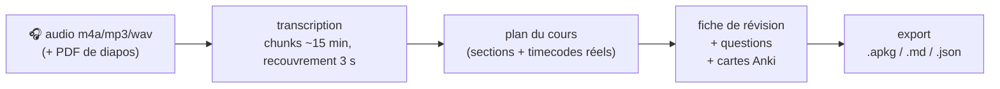

# revision-os

> **Un cours audio → une fiche, des questions type contrôle continu et des cartes Anki.**
> Pipeline Python en ligne de commande, pilotable par un agent (Claude, Cursor, OMP…) via un serveur MCP.

Je suis étudiant en L1 BioMIA à l'université de Rennes. Mes cours, ce sont des amphis de 90 minutes
que je ne veux pas réécouter deux fois. Ce dépôt, c'est le pipeline que j'ai construit pour les
transformer automatiquement en support de révision — et le MCP qui me permet de le conduire en
parlant à un agent : *« traite cet amphi, sors-moi la fiche et les cartes »*.



## Ce que ça produit concrètement

Pour un cours de 90 minutes, vous obtenez :

- **`transcript.md`** — la transcription mot-à-mot horodatée (chunks recollés, reprise possible en cas d'échec) ;
- **`plan.json`** — le découpage du cours en sections, chacune avec son résumé, ses notions et **ses timecodes réels** ;
- **`fiche.md`** — la fiche de révision : par section, une prose d'entrée, des puces `- **Notion** : explication`, une phrase de sortie ;
- **`questions.json`** — des questions type contrôle continu (≈ 6 pour 1000 mots de fiche), avec leurs réponses ;
- **`cards.json`** + **`export.apkg`** — **les mêmes questions en cartes** (une carte par question :
  recto = l'énoncé, verso = la réponse, plus les tags thème/priorité), prêtes pour Anki.

## Démarrage rapide

Prérequis : Python ≥ 3.11, `ffmpeg` installé, une clé [OpenRouter](https://openrouter.ai) (pay-as-you-go).

```bash
uv tool install git+https://github.com/ewiwlll/revision-os   # ou : pipx install …

export OPENROUTER_API_KEY=sk-or-...

revision-pipeline selftest                                   # vérifie l'installation (aucun réseau)

# 1. Audio → transcription (met en cache chaque chunk : relancer reprend où ça s'était arrêté)
revision-pipeline ingest --audio amphi-12.m4a --out out/transcript.md --title "Microbiologie CM2"

# 2. Transcription → plan (étape éditable à la main avant de générer)
revision-pipeline plan --transcript out/transcript.md --out out/plan.json

# 3. Plan + transcription → fiche, questions, cartes
#    (ajoutez --lang en pour traduire la sortie ; sinon tout suit la langue du cours)
revision-pipeline generate --transcript out/transcript.md --plan out/plan.json --outdir out

# 4. Cartes → deck Anki
revision-pipeline export --cards out/cards.json --out out/export.apkg --deck "Microbiologie"
```

Pas d'audio sous la main ? Testez avec l'extrait fourni : `examples/transcript-exemple.md`
(les étapes 2 à 4 tournent dessus pour moins d'un centime).

## Piloter tout ça depuis un agent (MCP)

Le serveur MCP expose le pipeline local comme des outils :

```jsonc
// ~/.config/claude/claude_desktop_config.json (ou mcp.json d'OMP / Cursor)
{
  "mcpServers": {
    "revision": {
      "command": "revision-mcp",
      "env": {
        "REVISION_WORKSPACE": "/Users/vous/revision",
        "OPENROUTER_API_KEY": "sk-or-..."
      }
    }
  }
}
```

Puis, en langage naturel : *« crée un cours “Photosynthèse CM3”, dépose `~/Downloads/amphi-3.m4a`,
lance la génération, et préviens-moi quand la fiche est prête »*. Les outils disponibles :
`liste_cours`, `creer_cours`, `deposer_fichier`, `lancer_generation`, `detail_cours`, `fiche`,
`cartes`, `exporter_anki`, `telecharger_fichier`.

> Le même serveur sait aussi parler à une **instance hébergée** (compte + jeton) : les outils
> `api_*` apparaissent si `REVISION_SAAS_URL` + `REVISION_SAAS_TOKEN` sont définis. Utile quand on ne
> veut rien installer côté machine — le mode hébergé peut facturer en crédits ou laisser chacun
> mettre **sa propre clé** (BYOK), au choix.

## Combien ça coûte (mesuré, pas estimé)

Le pipeline écrit un journal d'usage (`usage.jsonl`) : chaque appel LLM y laisse ses tokens et son
coût. Valeurs réelles, mesurées sur mes cours :

| Étape | Modèle | Coût pour 90 min d'audio |
|---|---|---|
| Transcription | `google/gemini-3.8-flash` | ≈ 0,20 $ |
| Plan | `deepseek/deepseek-v4.1-flash` | ≈ 0,03 $ |
| Fiche + questions | `deepseek/deepseek-v4.1-flash` | ≈ 0,09 $ |
| Légendes d'images (optionnel) | `deepseek/deepseek-v4.1-flash` | ≈ 0,01 $ |
| **Total** | | **≈ 0,30 $ (~0,28 €)** |

Soit **environ 0,30 € pour un cours de 90 minutes** — et ~0,07 € pour un cours de 25 minutes.
Les modèles se changent par variable d'environnement (`TRANSCRIBE_MODEL`, `GEN_MODEL`).

## Comment c'est construit (les choix qui comptent)

- **Découpage audio intelligent** : ~15 min par chunk avec **3 s de recouvrement**, normalisation
  ffmpeg (`highpass=f=80, loudnorm`, 16 kHz mono) pour réduire les erreurs de transcription ;
  chaque chunk est mis en cache → une coupure réseau ne fait pas tout recommencer.
- **Le plan est une étape, pas un détail** : le LLM propose un découpage, l'humain le valide (ou le
  corrige) avant la génération. C'est ce qui garantit que la fiche suit la structure réelle du cours.
- **La transcription est la seule source de vérité** : les diapos (PDF) servent à illustrer et à
  vérifier les termes, jamais à ajouter du contenu que le prof n'a pas dit.
- **Gates d'audit** : la génération vérifie la proportion questions/1000 mots, la couverture de
  toutes les sections, et refuse les questions administratives (celui qui pose « quel est le barème
  du TD ? » ne révise pas son cours).
- **Journal de coûts** : impossible de se ruiner par accident quand chaque appel est chiffré.
- **Langue** : la transcription est faite **dans la langue réellement parlée** (jamais traduite), et la
  fiche/questions la suivent par défaut. `--lang en` (ou `fr`, `es`…) traduit la sortie en gardant les
  termes techniques du cours, avec la traduction entre parenthèses à la première occurrence.
- **Formats de sortie standards** : Markdown (Obsidian), JSON (retraitement), `.apkg` (Anki).

## Ce qui n'est pas dans ce dépôt

Le **service hébergé** (interface web, comptes, crédits, file de jobs Postgres, Stripe) — c'est le
produit ; ici, c'est le moteur. Le MCP est livré avec, dans deux modes : local (ce dépôt) et
« instance hébergée » (une URL + un jeton).

## Limites (honnêtes)

- La qualité dépend de l'audio : un amphi bruité produit plus d'erreurs, surtout sur les noms
  propres et le vocabulaire scientifique rare.
- 90 minutes d'audio ≈ 5 à 15 minutes de traitement (transcription parallélisée + LLM).
- La *rédaction* des prompts est en français et le pipeline a été calibré sur des cours francophones ;
  la langue de transcription et la langue de sortie sont configurables (`--lang`), mais les autres
  langues sont moins éprouvées.
- Tests : `selftest` + un exemple fourni pour l'instant ; les tests unitaires arrivent au fur et à
  mesure (je développe ce dépôt pendant ma L1, pas à plein temps).
- Ça coûte ~0,30 $ par cours de 90 min : ce n'est pas gratuit, mais c'est le prix des modèles, pas
  celui d'un abonnement.

## Feuille de route

- mode 100 % local (Whisper) pour se passer de clé API ;
- révision espacée (FSRS) intégrée, aujourd'hui côté application ;
- portage des 7 scripts d'audit de ma chaîne actuelle en gates automatiques ;
- tests unitaires sur les modules d'ingestion et d'export.

## Licence

MIT — faites-en ce que vous voulez, attribution appréciée.
