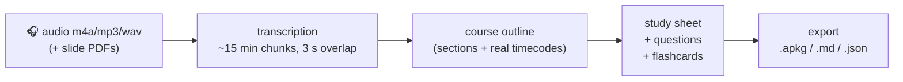

# revision-os

> **A lecture recording goes in. A study sheet, exam-style questions and Anki flashcards come out.**
> A Python pipeline with a CLI — and an MCP server so an agent (Claude, Cursor, OMP…) can drive it.

*Français ? → [README.fr.md](README.fr.md)*

I'm a first-year bioinformatics student (BioMIA, University of Rennes). My lectures are 90-minute
recordings I refuse to sit through twice. This repository is the pipeline I built to turn them into
revision material — plus the MCP server that lets me run it by talking to an agent:
*“process this lecture, give me the sheet and the flashcards.”*



## What you actually get

For a 90-minute lecture:

- **`transcript.md`** — word-for-word transcription with timestamps (chunks stitched, resumable on failure);
- **`plan.json`** — the lecture split into sections, each with a summary, key notions and **real timecodes**;
- **`fiche.md`** — the study sheet: per section, a short intro paragraph, `- **Key notion**: explanation` bullets, a closing sentence;
- **`questions.json`** — exam-style questions (≈ 6 per 1000 words of sheet), with answers;
- **`cards.json`** + **`export.apkg`** — **the same questions as flashcards** (one card per question:
  front = the question, back = the answer, plus theme/priority tags), ready for Anki.

## Quickstart

Requirements: Python ≥ 3.11, `ffmpeg`, an [OpenRouter](https://openrouter.ai) API key (pay-as-you-go).

```bash
uv tool install git+https://github.com/ewiwlll/revision-os   # or: pipx install …

export OPENROUTER_API_KEY=sk-or-...

revision-pipeline selftest                                   # sanity check (no network)

# 1. Audio → transcript (each chunk is cached: re-running resumes where it stopped)
revision-pipeline ingest --audio lecture-12.m4a --out out/transcript.md --title "Microbiology L2"

# 2. Transcript → outline (an editable step — fix it before generating)
revision-pipeline plan --transcript out/transcript.md --out out/plan.json

# 3. Outline + transcript → sheet, questions, flashcards
#    (add --lang en to translate the output; without it, everything follows the lecture's language)
revision-pipeline generate --transcript out/transcript.md --plan out/plan.json --outdir out

# 4. Flashcards → Anki deck
revision-pipeline export --cards out/cards.json --out out/export.apkg --deck "Microbiology"
```

No recording at hand? Use the bundled sample: `examples/transcript-exemple.md`
(steps 2–4 run on it for under a cent — measured: $0.008).

## Driving it from an agent (MCP)

The MCP server turns the local pipeline into tools:

```jsonc
// claude_desktop_config.json (or OMP's mcp.json / Cursor config)
{
  "mcpServers": {
    "revision": {
      "command": "revision-mcp",
      "env": {
        "REVISION_WORKSPACE": "/Users/you/revision",
        "OPENROUTER_API_KEY": "sk-or-..."
      }
    }
  }
}
```

Then, in plain language: *“create a course ‘Photosynthesis L3’, drop `~/Downloads/lecture-3.m4a`,
start generation, and ping me when the sheet is ready.”*
Available tools: `liste_cours`, `creer_cours`, `deposer_fichier`, `lancer_generation`,
`detail_cours`, `fiche`, `cartes`, `exporter_anki`, `telecharger_fichier`.

> The same server can also talk to a **hosted instance** (account + token): the `api_*` tools show up
> when `REVISION_SAAS_URL` and `REVISION_SAAS_TOKEN` are set — handy when you don't want to install
> anything. The hosted mode can bill in credits, or let users plug **their own API key** (BYOK),
> whichever they prefer.

## What it costs (measured, not estimated)

The pipeline writes a usage ledger (`usage.jsonl`): every LLM call logs its tokens and cost.
Real numbers, measured on my own lectures:

| Step | Model | Cost for 90 min of audio |
|---|---|---|
| Transcription | `google/gemini-3.8-flash` | ≈ $0.20 |
| Outline | `deepseek/deepseek-v4.1-flash` | ≈ $0.03 |
| Sheet + questions | `deepseek/deepseek-v4.1-flash` | ≈ $0.09 |
| Image captions (optional) | `deepseek/deepseek-v4.1-flash` | ≈ $0.01 |
| **Total** | | **≈ $0.30** |

So **about $0.30 per 90-minute lecture** (≈ $0.07 for a 25-minute one). Models are configurable via
environment variables (`TRANSCRIBE_MODEL`, `GEN_MODEL`).

## Design notes (the choices that matter)

- **Chunked transcription**: ~15 min per chunk with a **3 s overlap**, plus ffmpeg normalisation
  (`highpass=f=80, loudnorm`, 16 kHz mono) to cut down recognition errors. Every chunk is cached,
  so a dropped connection never means starting over.
- **The outline is a step, not a detail**: the LLM proposes the structure, the human corrects it
  before generation. That's what keeps the sheet faithful to the actual lecture.
- **The transcript is the single source of truth**: slide PDFs illustrate and help spell technical
  terms — they never add content the lecturer didn't say.
- **Audit gates**: the generator checks the questions-per-1000-words ratio, that every section is
  covered, and rejects administrative questions (“what's the grading scheme?” is not revision).
- **A cost ledger**: every call is priced, so a lecture can't silently cost a fortune.
- **Language**: the transcript is transcribed **in the language actually spoken** (never translated), and
  the sheet/questions follow it by default. `--lang en` (or `fr`, `es`…) translates the output while
  keeping the lecture's technical terms, with a translation in parentheses on first use.
- **Standard output formats**: Markdown (Obsidian), JSON (reprocessing), `.apkg` (Anki).

## What is *not* in this repository

The **hosted service** (web app, accounts, credits, Postgres job queue, Stripe) — that's the
product. This repo is the engine. The MCP ships with it in two modes: local (this repo) and
“hosted instance” (a URL + a token).

## Honest limitations

- Output quality tracks audio quality: a noisy lecture hall means more errors, especially on proper
  nouns and rare scientific vocabulary.
- 90 minutes of audio ≈ 5–15 minutes of processing (parallel transcription + LLM calls).
- Prompt *wording* is in French, and the pipeline was tuned on French lectures; the transcript and the
  output language are configurable (`--lang`), but other languages are less battle-tested.
- Tests: `selftest` plus the bundled example for now; unit tests are coming as the repo grows
  (I maintain this during my first year of university, not full-time).
- It is not free: ~$0.30 per 90-minute lecture — that's the model cost, not a subscription.

## Roadmap

- fully local mode (Whisper) to drop the API key requirement;
- built-in spaced repetition (FSRS), currently living in the hosted app;
- porting my seven audit scripts into automatic gates;
- unit tests for the ingestion and export modules.

## License

MIT — do whatever you want with it; attribution appreciated.
